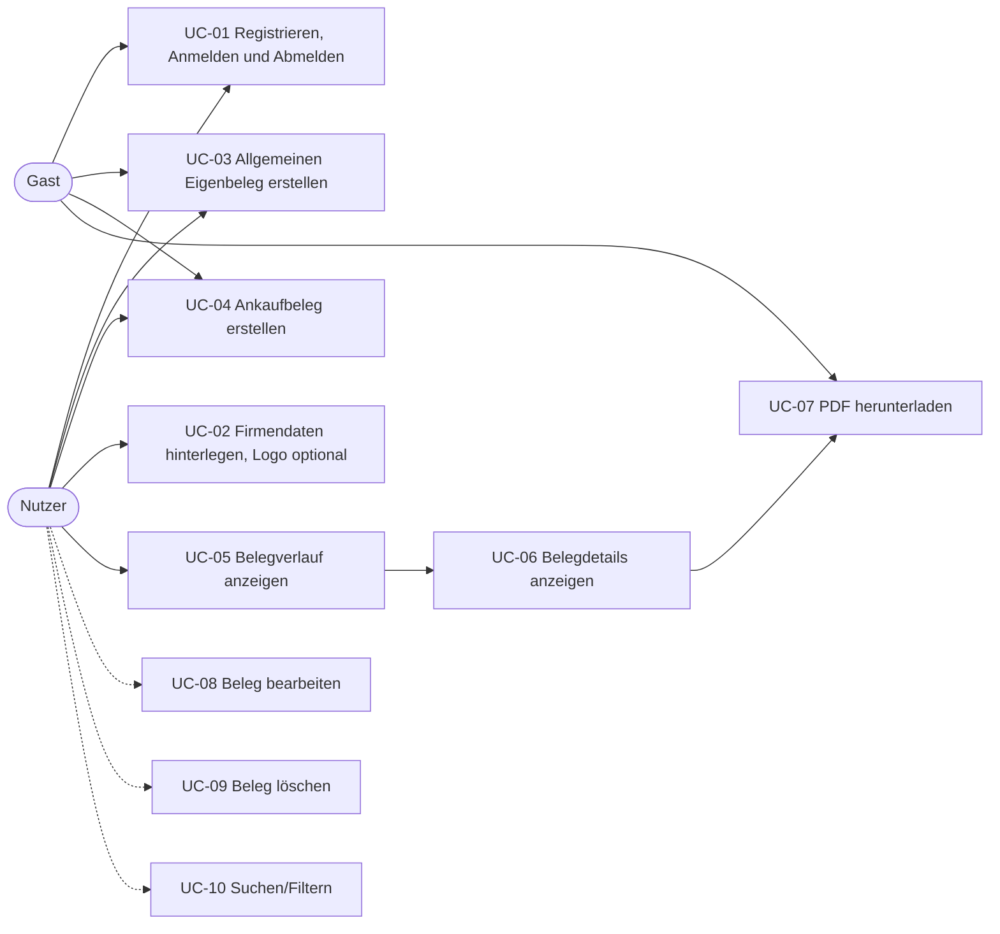

# Use Cases: Eigenbeleg Generator

Dieses Dokument beschreibt, was Nutzer mit dem Eigenbeleg Generator tun können, und ordnet jeden Use Case den Abgaben M2, M3, M4 und der finalen Abgabe zu. Am Ende steht der Screenshot-Plan für die finale Abgabe.

> **Hinweis:** Hochschulprojekt mit fiktiven Testdaten. Die fachlichen Regeln (Pflichtangaben eines Eigenbelegs) sind vereinfacht und ersetzen keine Steuerberatung.

**Grundprinzip:** Den Beleg-Generator kann jede Person ohne Konto als Gast nutzen und das PDF herunterladen. Ein Konto dient in erster Linie dazu, Belege **zu speichern**: Nur angemeldete Nutzer haben einen Belegverlauf. Belege von Gästen ohne Konto werden nicht gespeichert und erscheinen in keinem Verlauf. Die Firmendaten des Ausstellers (Name und Anschrift) sind Pflicht, denn der Beleg muss zeigen, wer ihn ausstellt. Das Logo ist dagegen optional, denn ein Eigenbeleg entsteht gerade, weil das Gegenüber keine Rechnung oder Quittung ausgestellt hat. Jeder Beleg kann eine fortlaufende Belegnummer tragen: Bei Nutzern vergibt sie das System automatisch, Gäste tragen sie selbst ein.

## Inhalt

- [Akteure](#akteure)
- [Übersicht](#übersicht)
- [Use Cases im Detail](#use-cases-im-detail)
- [Zuordnung zu den Abgaben](#zuordnung-zu-den-abgaben)
- [Screenshot-Plan für die finale Abgabe](#screenshot-plan-für-die-finale-abgabe)
- [Testideen je Use Case](#testideen-je-use-case)

## Akteure

| Akteur | Beschreibung |
| --- | --- |
| Gast | Person ohne Konto oder nicht angemeldet. Kann den Beleg-Generator nutzen und das PDF herunterladen, **ohne** dass der Beleg gespeichert wird. Hat keinen Belegverlauf. Kann sich registrieren oder anmelden. |
| Nutzer | Angemeldete Person, z. B. Selbstständige oder Gebrauchtwarenhändler. Erstellt Belege wie ein Gast, aber sie werden gespeichert. Sieht und verwaltet nur die eigenen Belege. |
| System | Spring-Boot-Backend mit PostgreSQL-Datenbank. Prüft Eingaben, vergibt Belegnummern (nur für gespeicherte Belege), speichert Daten und erzeugt PDFs. |

## Übersicht

| ID | Use Case | Akteur | Priorität | Frühester Meilenstein |
| --- | --- | --- | --- | --- |
| UC-01 | Registrieren, Anmelden und Abmelden | Gast / Nutzer | Muss | Finale Abgabe |
| UC-02 | Firmendaten hinterlegen (Logo optional) | Nutzer | Muss | Finale Abgabe |
| UC-03 | Allgemeinen Eigenbeleg erstellen | Gast / Nutzer | Muss | M4 |
| UC-04 | Ankaufbeleg von Privat erstellen | Gast / Nutzer | Muss | M4 |
| UC-05 | Belegverlauf anzeigen | Nutzer | Muss | M2 |
| UC-06 | Belegdetails anzeigen | Nutzer | Muss | Finale Abgabe |
| UC-07 | Beleg als PDF herunterladen | Gast / Nutzer | Muss | Finale Abgabe |
| UC-08 | Beleg bearbeiten | Nutzer | Kann | Finale Abgabe |
| UC-09 | Beleg löschen | Nutzer | Kann | Finale Abgabe |
| UC-10 | Verlauf durchsuchen und filtern | Nutzer | Kann | Finale Abgabe |

Routen und Frontend-Pfade in den Use Cases sind Vorschläge. Bereits umgesetzt ist nur `GET /api/receipts` mit fest im Code hinterlegten Beispielbelegen (M1).

## Use Cases im Detail

### UC-01: Registrieren, Anmelden und Abmelden

| Feld | Inhalt |
| --- | --- |
| Priorität | Muss |
| Akteur | Gast (Registrieren, Anmelden), Nutzer (Abmelden) |
| Ziel | Ein Konto anlegen oder sich anmelden, damit Belege gespeichert werden, im Verlauf erscheinen und nur dem Ersteller gehören, und die Sitzung wieder beenden. Ohne Konto bleibt die Webseite als Gast nutzbar, Belege werden dann aber nicht gespeichert. |
| Meilenstein | Finale Abgabe |
| Vorbedingungen | Registrieren: Die Person hat noch kein Konto. Anmelden: Ein Konto existiert. Abmelden: Der Nutzer ist angemeldet. |
| Nachbedingung | Nach dem Registrieren ist ein neuer `User` gespeichert (Passwort nur als Hash). Der Nutzer ist angemeldet und landet auf den Firmendaten (UC-02). Nach dem Speichern der Firmendaten folgt der leere Belegverlauf (UC-05). Nach dem Anmelden werden erstellte Belege gespeichert, und Verlauf und Detailansicht zeigen nur Belege mit eigener `ownerId`. Nach dem Abmelden sind Verlauf und Detailansicht wieder gesperrt. Als Gast bleibt der Beleg-Generator nutzbar, es wird aber nichts gespeichert. |
| Backend-Route | `POST /api/auth/register`, `POST /api/auth/login`, `POST /api/auth/logout` |
| Frontend | `/registrieren`, `/anmelden`, Schaltfläche „Abmelden“ in der Navigationsleiste, Schaltfläche „Als Gast fortfahren“ auf der Startseite und auf `/anmelden` |
| Screenshot | Anmeldeseite mit Anmeldeformular, Link „Konto erstellen“ und Schaltfläche „Als Gast fortfahren“, daneben die Navigationsleiste mit angemeldeter E-Mail und „Abmelden“. |

**Hauptablauf (Registrieren)**

1. Gast klickt auf der Startseite oder im Belegformular (Hinweis „Zum Speichern anmelden“) auf „Registrieren“.
2. System zeigt das Formular mit E-Mail, Passwort und Passwort-Wiederholung.
3. Gast füllt die Felder aus und klickt auf „Konto erstellen“.
4. System prüft die Eingaben, legt das Konto an und meldet den Nutzer an.
5. System leitet zu den Firmendaten (UC-02) weiter, weil diese vor dem ersten gespeicherten Beleg hinterlegt werden müssen. Danach folgt der Belegverlauf (UC-05).

**Hauptablauf (Anmelden und Abmelden)**

1. Gast öffnet „Anmelden“ und gibt E-Mail und Passwort ein.
2. System prüft die Zugangsdaten und startet eine Sitzung.
3. System zeigt den Belegverlauf (UC-05) und in der Navigationsleiste die E-Mail des Nutzers.
4. Nutzer klickt später auf „Abmelden“.
5. System beendet die Sitzung und zeigt die Startseite.

**Alternativabläufe**

- **1a** Die Person möchte kein Konto: Sie klickt auf der Startseite oder auf der Anmeldeseite auf „Als Gast fortfahren“. Das System öffnet das Belegformular (UC-03, UC-04). Der Beleg kann erstellt und als PDF heruntergeladen werden (UC-07), wird aber nicht gespeichert und erscheint in keinem Verlauf.
- **2a** Zugangsdaten sind falsch: Das System meldet „E-Mail oder Passwort falsch“, ohne zu verraten, welches von beiden.
- **2b** Ein Gast ruft direkt eine geschützte Seite wie `/belege` (Verlauf, Details) oder `/einstellungen/firma` auf: Das System leitet zur Anmeldung um und danach zurück zur gewünschten Seite. Die Belegformulare (UC-03, UC-04) sind **nicht** geschützt.
- **3a** E-Mail ist ungültig, Passwort hat weniger als 8 Zeichen oder die Wiederholung stimmt nicht: Das System markiert das Feld und zeigt eine verständliche Meldung. Es wird nichts gespeichert.
- **4a** Die E-Mail ist bereits registriert: Das System meldet „Für diese E-Mail gibt es schon ein Konto“ und verlinkt die Anmeldung.

### UC-02: Firmendaten hinterlegen (Logo optional)

| Feld | Inhalt |
| --- | --- |
| Priorität | Muss |
| Akteur | Nutzer |
| Ziel | Firmenname und Anschrift einmal speichern, damit sie automatisch auf jedem Beleg-PDF erscheinen, und den Nummernkreis für die fortlaufende Belegnummer festlegen. Das Logo ist optional: Ein Eigenbeleg ersetzt eine fehlende Rechnung oder Quittung des Gegenübers und braucht deshalb kein Logo. |
| Meilenstein | Finale Abgabe |
| Vorbedingungen | Nutzer ist angemeldet (UC-01). |
| Nachbedingung | Ein `CompanyProfile` mit Firmenname und Anschrift ist für den Nutzer gespeichert. Jeder danach gespeicherte Beleg übernimmt Firmenname und Anschrift als Kopie (`issuerName`, `issuerAddress`, siehe UC-03). Bereits gespeicherte Belege und ihre PDFs bleiben unverändert. Das Logo erscheint, falls vorhanden, auf allen PDFs. |
| Backend-Route | `GET /api/company-profile`, `PUT /api/company-profile`, `POST /api/company-profile/logo` |
| Frontend | `/einstellungen/firma` |
| Screenshot | Einstellungsseite mit ausgefüllten Firmendaten und Vorschau des hochgeladenen Logos. |

**Hauptablauf**

1. Nutzer öffnet „Einstellungen → Firmendaten“.
2. System zeigt das Formular, vorausgefüllt mit bisher gespeicherten Werten.
3. Nutzer gibt Firmenname (Pflicht), Inhaber, Anschrift (Pflicht) und optional die Steuernummer ein.
4. Nutzer legt den Nummernkreis fest: Präfix (Standard `EB`) und nächste Nummer im laufenden Jahr (Standard 1). Die Belegnummer hat das Format Präfix-Jahr-Nummer, z. B. `EB-2026-0004`. So kann er an eine bereits bestehende Nummerierung anknüpfen. Am 1. Januar beginnt die Zählung automatisch wieder bei 1, das Präfix bleibt.
5. Nutzer wählt optional eine Logodatei aus. Das System zeigt eine Vorschau.
6. Nutzer klickt auf „Speichern“. Das System speichert die Daten und bestätigt das.

**Alternativabläufe**

- **3a** Firmenname oder Anschrift fehlen: Das System markiert die Pflichtfelder und speichert nicht.
- **4a** Die nächste Nummer ist keine positive ganze Zahl oder bereits vergeben: Das System lehnt sie ab und nennt die nächste freie Nummer.
- **5a** Die Datei ist kein PNG oder JPG oder größer als 1 MB: Das System lehnt sie mit Hinweis auf erlaubte Formate ab. Das bisherige Logo bleibt erhalten.
- **5b** Nutzer entfernt das Logo: Das System löscht es, und folgende PDFs erscheinen ohne Logo. Die Firmendaten bleiben.
- **6a** Nutzer will einen Beleg speichern, bevor Firmendaten existieren: Das Belegformular verweist mit einem Link auf die Firmendaten, der Beleg wird erst danach gespeichert.

### UC-03: Allgemeinen Eigenbeleg erstellen

| Feld | Inhalt |
| --- | --- |
| Priorität | Muss |
| Akteur | Gast (ohne Speichern), Nutzer (mit Speichern) |
| Ziel | Für eine Ausgabe ohne Originalbeleg (Parkautomat ohne Quittung, Trinkgeld, verlorene Quittung) einen vollständigen Eigenbeleg erstellen. Angemeldete Nutzer speichern ihn zusätzlich im Verlauf. |
| Meilenstein | M4 (Speichern über `POST /api/receipts` in PostgreSQL), Gast-Modus und Login-Bezug ab finaler Abgabe |
| Vorbedingungen | **Nutzer:** Firmendaten sind hinterlegt (UC-02). **Gast:** Keine, er gibt die Ausstellerdaten im Formular ein, der Beleg wird nicht gespeichert. In M4 gibt es noch keinen Login und keine Firmendaten, dort werden alle Belege gespeichert. |
| Nachbedingung | **Nutzer:** Ein neuer `Receipt` mit `type` = `ALLGEMEIN` ist in der Datenbank gespeichert und erscheint oben im Belegverlauf (UC-05). **Gast:** Es wird nichts gespeichert. Der Gast erhält direkt das PDF (UC-07). |
| Backend-Route | Nutzer: `POST /api/receipts` (JSON, speichert). Gast: `POST /api/receipts/pdf` als `multipart/form-data` mit dem Teil `receipt` (Belegdaten als JSON) und dem optionalen Teil `logo` (Bilddatei). Erzeugt das PDF und speichert nichts. |
| Frontend | `/belege/neu?typ=allgemein` (ohne Anmeldung erreichbar) |
| Screenshot | Eingabemaske „Neuer Eigenbeleg“ mit ausgefüllten Feldern, Steuerauswahl `REGELSATZ_19` und Schaltfläche „Beleg speichern“ (angemeldet). Zusätzlich dieselbe Maske ohne Anmeldung mit Hinweis „Als Gast – Beleg wird nicht gespeichert“ und Schaltfläche „PDF erstellen“. |

**Felder der Eingabemaske** (Abbildung auf die Entity `Receipt`)

`issuerName` und `issuerAddress` sind neue Felder der Entity. `Receipt.java` hat sie seit dem 19.10.2026, befüllt werden sie ab der finalen Abgabe. Bei Nutzern speichern sie eine Kopie der Firmendaten zum Zeitpunkt des Speicherns, damit spätere Änderungen am Firmenprofil alte Belege nicht verändern. Bei Gästen kommen sie aus dem Formular und werden nicht gespeichert.

| Feld in der Maske | Entity-Feld | Regel |
| --- | --- | --- |
| Belegart | `type` | Fest `ALLGEMEIN` (nicht änderbar in dieser Maske) |
| Datum der Zahlung | `paymentDate` | Pflicht, nicht in der Zukunft |
| Ausstellungsdatum | `issueDate` | Pflicht, Standard heute, nicht vor `paymentDate` |
| Zahlungsempfänger | `payeeName` | Pflicht, höchstens 200 Zeichen |
| Anschrift des Empfängers | `payeeAddress` | Optional, aber empfohlen |
| Art der Aufwendung | `description` | Pflicht, höchstens 500 Zeichen |
| Betrag (brutto, in Euro) | `amountCents` | Pflicht, größer als 0. Eingabe „4,50“ wird als 450 Cent gespeichert. |
| Umsatzsteuer | `vatRate` | Pflicht: `REGELSATZ_19` (Vorbelegung), `ERMAESSIGT_7` oder `OHNE_UST` |
| Grund für fehlenden Originalbeleg | `reason` | Pflicht, höchstens 500 Zeichen |
| Zahlungsart | `paymentMethod` | Pflicht: `BAR` (Vorbelegung), `UEBERWEISUNG` oder `KARTE` |
| Name des Ausstellers (nur Gast) | `issuerName` | Pflicht, höchstens 200 Zeichen. Nutzer sehen das Feld nicht, das System setzt es beim Speichern (siehe unten). |
| Anschrift des Ausstellers (nur Gast) | `issuerAddress` | Pflicht. Nutzer sehen das Feld nicht, das System setzt es beim Speichern (siehe unten). |
| Belegnummer (nur Gast) | `number` | Optional, vom Gast selbst eingetragen, höchstens 30 Zeichen, z. B. `EB-2026-0001`. Bleibt das Feld leer, trägt das PDF keine Nummer. |
| (vom System gesetzt, nur bei Speichern) | `id` | Neue UUID |
| (vom System gesetzt, nur bei Speichern) | `number` | Fortlaufend je Nutzer und Jahr nach dem Nummernkreis aus UC-02, z. B. `EB-2026-0004`. Am 1. Januar beginnt die Zählung neu. In M4 ohne Login fortlaufend über alle Belege. |
| (vom System gesetzt, nur bei Speichern) | `issuerName`, `issuerAddress` | Kopie von Firmenname und Anschrift aus den Firmendaten (UC-02) zum Zeitpunkt des Speicherns. In M4 ohne Firmendaten leer. |
| (vom System gesetzt, nur bei Speichern) | `createdAt` | Aktueller Zeitpunkt |
| (vom System gesetzt, nur bei Speichern) | `ownerId` | ID des angemeldeten Nutzers. In M4 bleibt sie leer (`null`). |

**Hauptablauf (Nutzer, angemeldet)**

1. Nutzer klickt im Belegverlauf auf „Neuer Beleg → Allgemeiner Eigenbeleg“.
2. System zeigt die Eingabemaske mit Vorbelegungen (heutiges Datum, `REGELSATZ_19`, `BAR`).
3. Nutzer füllt die Felder aus. Kurze Hilfetexte erklären jedes Feld, z. B. „Warum gibt es keine Quittung?“.
4. Nutzer klickt auf „Beleg speichern“.
5. System prüft die Eingaben (Bean Validation im Backend, gleiche Regeln im Frontend), vergibt `id`, `number` und `createdAt`, übernimmt `issuerName` und `issuerAddress` aus den Firmendaten und speichert den Beleg.
6. System zeigt die Detailansicht des neuen Belegs (UC-06) mit der Meldung „Beleg EB-2026-0004 gespeichert“.

**Hauptablauf (Gast, nicht angemeldet)**

1. Gast klickt auf der Startseite auf „Als Gast fortfahren“ und wählt „Allgemeiner Eigenbeleg“.
2. System zeigt dieselbe Eingabemaske mit Vorbelegungen und dem Hinweis „Du nutzt die Seite als Gast. Der Beleg wird nicht gespeichert und erscheint in keinem Verlauf. Melde dich an, um Belege zu speichern.“ mit Links zu Anmeldung und Registrierung.
3. Gast füllt die Felder aus, auch Name und Anschrift des Ausstellers, und trägt optional eine eigene Belegnummer ein. Ein Logo kann er optional hinzufügen (PNG oder JPG, höchstens 1 MB). Es wird nicht gespeichert.
4. Gast klickt auf „PDF erstellen“.
5. System prüft die Eingaben mit denselben Regeln, erzeugt das PDF (UC-07) und speichert nichts.
6. Frontend startet den Download und zeigt den Hinweis „PDF erstellt, nicht gespeichert“ mit dem Angebot, ein Konto anzulegen.

**Alternativabläufe**

- **4a** Pflichtfeld fehlt oder eine Regel ist verletzt (z. B. Betrag 0 oder Zahlungsdatum in der Zukunft): Das Frontend markiert das Feld vor dem Absenden. Lehnt das Backend trotzdem ab (HTTP 400), zeigt das Frontend die Meldungen am jeweiligen Feld an.
- **5a** Das Backend ist nicht erreichbar: Das Frontend zeigt „Speichern fehlgeschlagen, bitte erneut versuchen“ (Gast: „PDF konnte nicht erstellt werden“). Die Eingaben bleiben erhalten.
- **5b** Das Backend auf Render ist im Ruhezustand und startet erst: Das Frontend zeigt während der Wartezeit einen Ladehinweis statt eines Fehlers.
- **5c** Ein Gast meldet sich nach dem Ausfüllen an oder registriert sich: Das Frontend behält die eingegebenen Belegdaten. Nach einer Registrierung hinterlegt er zuerst die Firmendaten (UC-02). Danach bietet das Formular „Beleg speichern“ an, und die Ausstellerdaten kommen aus den Firmendaten statt aus dem Formular.

### UC-04: Ankaufbeleg von Privat erstellen

| Feld | Inhalt |
| --- | --- |
| Priorität | Muss |
| Akteur | Gast (ohne Speichern), Nutzer (mit Speichern, z. B. Gebrauchtwarenhändler) |
| Ziel | Den Ankauf gebrauchter Ware von einer Privatperson ohne Rechnung belegen. |
| Meilenstein | M4 (gleiche Route wie UC-03, nur `type` = `ANKAUF`), sonst finale Abgabe |
| Vorbedingungen | Wie UC-03: **Nutzer:** Firmendaten sind hinterlegt (UC-02). **Gast:** Keine, er gibt die Ausstellerdaten im Formular ein, der Beleg wird nicht gespeichert. |
| Nachbedingung | **Nutzer:** Ein neuer `Receipt` mit `type` = `ANKAUF` ist gespeichert. **Gast:** Es wird nichts gespeichert. In beiden Fällen enthält das PDF (UC-07) Unterschriftsfelder für Käufer und Verkäufer. |
| Backend-Route | Nutzer: `POST /api/receipts`. Gast: `POST /api/receipts/pdf` (wie UC-03). |
| Frontend | `/belege/neu?typ=ankauf` (ohne Anmeldung erreichbar) |
| Screenshot | Eingabemaske „Neuer Ankaufbeleg“ mit Verkäuferdaten, gekauftem Artikel und Steuerauswahl `OHNE_UST`. |

Gleiche Felder wie in UC-03, mit diesen Unterschieden:

| Feld | Unterschied zu UC-03 |
| --- | --- |
| `type` | Fest `ANKAUF` |
| `payeeName` | Beschriftet als „Name des Verkäufers“, Pflicht |
| `payeeAddress` | Beschriftet als „Anschrift des Verkäufers“, **Pflicht** |
| `description` | Beschriftet als „Gekaufter Artikel“, möglichst mit Modell oder Seriennummer |
| `vatRate` | Vorbelegung `OHNE_UST`, da Privatpersonen keine Umsatzsteuer ausweisen |
| `reason` | Vorbelegt mit „Ankauf von Privatperson ohne Rechnung“, änderbar |

**Hauptablauf**

1. Nutzer klickt auf „Neuer Beleg → Ankauf von Privat“. Ein Gast wählt auf der Startseite „Als Gast fortfahren“ und dann „Ankauf von Privat“.
2. System zeigt die Ankauf-Maske mit Vorbelegungen (`OHNE_UST`, `BAR`, Grund vorausgefüllt). Ohne Anmeldung steht darüber der Hinweis aus UC-03, dass der Beleg nicht gespeichert wird.
3. Nutzer bzw. Gast erfasst Verkäufer, Anschrift, Artikel, Kaufdatum und Kaufpreis.
4. Nutzer klickt auf „Beleg speichern“, Gast auf „PDF erstellen“.
5. System prüft die Eingaben. Für Nutzer vergibt es die nächste Belegnummer und speichert den Beleg. Für Gäste erzeugt es nur das PDF.
6. Nutzer sieht die Detailansicht (UC-06) mit dem Hinweis, das PDF auszudrucken und vom Verkäufer unterschreiben zu lassen. Der Gast erhält direkt den PDF-Download mit demselben Hinweis.

**Alternativabläufe**

- **3a** Anschrift des Verkäufers fehlt: Das System verlangt sie, weil ein Ankaufbeleg ohne Anschrift des Verkäufers nicht nachvollziehbar ist.
- **3b** Nutzer ändert die Steuerauswahl auf `REGELSATZ_19`: Das System erlaubt das, zeigt aber den Hinweis „Bei Privatpersonen fällt in der Regel keine Umsatzsteuer an“.
- **5a** Fehler beim Speichern bzw. beim Erzeugen des PDFs: wie UC-03, Alternativablauf 5a.

### UC-05: Belegverlauf anzeigen

| Feld | Inhalt |
| --- | --- |
| Priorität | Muss |
| Akteur | Nutzer |
| Ziel | Alle eigenen gespeicherten Belege auf einen Blick sehen und einen davon zum Öffnen auswählen. Gäste haben keinen Verlauf, weil ihre Belege nicht gespeichert werden. |
| Meilenstein | M2 (Beispieldaten im Frontend, `v-for`), M3 (Daten über `GET /api/receipts`), M4 (Daten aus PostgreSQL) |
| Vorbedingungen | Ab finaler Abgabe: Nutzer ist angemeldet. Ein nicht angemeldeter Gast wird zur Anmeldung umgeleitet (UC-01, 2b). |
| Nachbedingung | Die Liste zeigt alle Belege des Nutzers, neueste zuerst. Es werden keine Daten verändert. |
| Backend-Route | `GET /api/receipts` |
| Frontend | `/belege`, Komponente `ReceiptList.vue` |
| Screenshot | Belegverlauf mit mehreren Einträgen (Nummer, Datum, Empfänger, Art, Betrag in Euro) und der Schaltfläche „Neuer Beleg“. |

**Hauptablauf**

1. Nutzer öffnet „Meine Belege“. Nach dem Anmelden ist das die Startansicht.
2. Frontend ruft `GET /api/receipts` auf und zeigt währenddessen einen Ladehinweis.
3. System liefert die Belege des Nutzers als JSON.
4. Frontend rendert je Beleg eine Zeile mit `v-for`: `number`, `paymentDate`, `payeeName`, `type` (als „Allgemein“ oder „Ankauf“) und `amountCents` als Euro-Betrag („4,50 €“).
5. Nutzer klickt auf eine Zeile und gelangt zur Detailansicht (UC-06).

**Alternativabläufe**

- **3a** Es gibt noch keine Belege: Das Frontend zeigt „Noch keine Belege – lege deinen ersten Eigenbeleg an“ mit Verweis auf UC-03.
- **3b** Das Backend ist nicht erreichbar: Das Frontend zeigt eine Fehlermeldung mit der Schaltfläche „Erneut laden“.

### UC-06: Belegdetails anzeigen

| Feld | Inhalt |
| --- | --- |
| Priorität | Muss |
| Akteur | Nutzer |
| Ziel | Alle Angaben eines einzelnen gespeicherten Belegs prüfen, bevor er ausgedruckt oder abgelegt wird. |
| Meilenstein | Finale Abgabe |
| Vorbedingungen | Der Beleg existiert und gehört dem angemeldeten Nutzer. |
| Nachbedingung | Alle Felder des Belegs werden angezeigt. Es werden keine Daten verändert. |
| Backend-Route | `GET /api/receipts/{id}` |
| Frontend | `/belege/:id` |
| Screenshot | Detailansicht eines Ankaufbelegs mit allen Feldern und der Schaltfläche „PDF herunterladen“. |

**Hauptablauf**

1. Nutzer wählt im Belegverlauf einen Beleg aus.
2. Frontend ruft `GET /api/receipts/{id}` auf.
3. System liefert den Beleg.
4. Frontend zeigt alle Angaben lesbar an: Steuerauswahl als Text (z. B. „19 % USt enthalten“), Betrag in Euro, Daten im Format TT.MM.JJJJ.
5. Nutzer kann von hier das PDF herunterladen (UC-07) oder zum Verlauf zurückkehren.

**Alternativabläufe**

- **3a** Der Beleg existiert nicht oder gehört einem anderen Nutzer: Das System antwortet mit HTTP 404. Das Frontend zeigt „Beleg nicht gefunden“ und einen Link zum Verlauf. Fremde Belege werden bewusst nicht als „verboten“ gemeldet, damit sich ihre Existenz nicht erraten lässt.

### UC-07: Beleg als PDF herunterladen

| Feld | Inhalt |
| --- | --- |
| Priorität | Muss |
| Akteur | Gast (direkt nach dem Ausfüllen), Nutzer (aus Detailansicht oder Verlauf) |
| Ziel | Einen einheitlich gestalteten Eigenbeleg als PDF erhalten, ausdrucken, unterschreiben und der Buchhaltung beilegen. |
| Meilenstein | Finale Abgabe |
| Vorbedingungen | **Nutzer:** Der Beleg existiert und gehört dem Nutzer, die Firmendaten (UC-02) sind hinterlegt. **Gast:** Das Belegformular (UC-03/UC-04) ist gültig ausgefüllt, einschließlich der Ausstellerdaten. Das Logo ist für beide optional. |
| Nachbedingung | Der Browser lädt das PDF herunter (Nutzer: `EB-2026-0004.pdf`, Gast: z. B. `Eigenbeleg-2026-10-18.pdf`). Für Nutzer kann dasselbe PDF jederzeit erneut erzeugt werden, weil es aus den gespeicherten Daten entsteht, einschließlich der Ausstellerdaten-Kopie. Spätere Änderungen an den Firmendaten ändern es nicht. Für Gäste wird nichts gespeichert. |
| Backend-Route | Nutzer: `GET /api/receipts/{id}/pdf`. Gast: `POST /api/receipts/pdf` als `multipart/form-data` (Teil `receipt` mit den Belegdaten als JSON, optionaler Teil `logo`). Die Antwort ist das PDF. |
| Frontend | Nutzer: Schaltfläche „PDF herunterladen“ in `/belege/:id` und im Verlauf. Gast: Schaltfläche „PDF erstellen“ im Belegformular. |
| Screenshot | Geöffnetes PDF mit Firmenkopf, Belegnummer, allen Angaben und Unterschriftszeile, bei hinterlegtem Logo zusätzlich mit Logo. |

**Inhalt des PDFs**

- Kopf: `issuerName` und `issuerAddress` aus dem Beleg (bei Nutzern die beim Speichern übernommene Kopie der Firmendaten, bei Gästen die Angaben aus dem Formular), dazu das Logo, falls vorhanden. Das Logo ist nur Gestaltung und kommt bei Nutzern aus dem aktuellen Firmenprofil.
- Titel „Eigenbeleg“ oder „Ankaufbeleg“, dazu `number` (bei Gästen nur, wenn sie eine Nummer eingetragen haben)
- `paymentDate`, `issueDate`, `payeeName`, `payeeAddress`, `description`
- Betrag in Euro, Steuerhinweis aus `vatRate`, `paymentMethod`
- `reason` („Grund für fehlenden Originalbeleg“)
- Unterschriftszeile des Ausstellers, bei `ANKAUF` zusätzlich eine für den Verkäufer

**Hauptablauf (Nutzer)**

1. Nutzer klickt in der Detailansicht auf „PDF herunterladen“.
2. Frontend ruft `GET /api/receipts/{id}/pdf` auf.
3. System erzeugt das PDF serverseitig aus dem gespeicherten Beleg (inklusive `issuerName` und `issuerAddress`) und dem Logo aus dem Firmenprofil.
4. Browser lädt die Datei mit der Belegnummer als Dateinamen herunter.

**Hauptablauf (Gast)**

1. Gast klickt im Belegformular auf „PDF erstellen“ (UC-03, UC-04).
2. Frontend sendet die Formulardaten per `POST /api/receipts/pdf` als `multipart/form-data` (Belegdaten als JSON-Teil, Logo als optionaler Datei-Teil).
3. System prüft die Daten und erzeugt das PDF mit den Ausstellerdaten aus dem Formular. Es speichert nichts.
4. Browser lädt die Datei herunter. Das Frontend weist darauf hin, dass der Beleg nicht gespeichert wurde.

**Alternativabläufe**

- **3a** Es gibt kein Logo: Das PDF wird ohne Logo erzeugt, der Firmenkopf bleibt. Das ist kein Fehler.
- **3b** Fehler bei der Erzeugung: Das System antwortet mit HTTP 500. Das Frontend zeigt „PDF konnte nicht erstellt werden“.
- **3c** Gast sendet ungültige Daten: Das System antwortet mit HTTP 400, das Frontend zeigt die Meldungen am jeweiligen Feld.

### UC-08: Beleg bearbeiten

| Feld | Inhalt |
| --- | --- |
| Priorität | Kann (nur bei übriger Zeit) |
| Akteur | Nutzer |
| Ziel | Tippfehler in einem gespeicherten Beleg korrigieren. |
| Meilenstein | Finale Abgabe, falls Zeit bleibt |
| Vorbedingungen | Der Beleg existiert und gehört dem angemeldeten Nutzer. |
| Nachbedingung | Der Beleg ist geändert. `number` und `createdAt` bleiben gleich, die Änderung ist nachvollziehbar protokolliert. |
| Backend-Route | `PUT /api/receipts/{id}` |
| Frontend | Schaltfläche „Bearbeiten“ in `/belege/:id` |
| Screenshot | Nur falls umgesetzt: Bearbeitungsmaske, vorausgefüllt mit den gespeicherten Werten. |

**Hauptablauf**

1. Nutzer klickt in der Detailansicht auf „Bearbeiten“.
2. System zeigt die Maske aus UC-03 bzw. UC-04, vorausgefüllt mit den gespeicherten Werten.
3. Nutzer ändert Angaben und klickt auf „Speichern“.
4. System prüft die Eingaben wie in UC-03, speichert die Änderung und zeigt die Detailansicht (UC-06).

**Alternativabläufe**

- **4a** Eine Regel ist verletzt: Das System zeigt die Meldung am jeweiligen Feld und speichert nichts.

### UC-09: Beleg löschen

| Feld | Inhalt |
| --- | --- |
| Priorität | Kann (nur bei übriger Zeit) |
| Akteur | Nutzer |
| Ziel | Einen versehentlich angelegten Beleg entfernen. |
| Meilenstein | Finale Abgabe, falls Zeit bleibt |
| Vorbedingungen | Der Beleg existiert und gehört dem angemeldeten Nutzer. |
| Nachbedingung | Der Beleg ist gelöscht und erscheint nicht mehr im Verlauf. Seine Belegnummer wird nicht neu vergeben. |
| Backend-Route | `DELETE /api/receipts/{id}` |
| Frontend | Schaltfläche „Löschen“ in `/belege/:id` |
| Screenshot | Nur falls umgesetzt: Rückfrage „Beleg wirklich löschen?“. |

**Hauptablauf**

1. Nutzer klickt in der Detailansicht auf „Löschen“.
2. System fragt „Beleg wirklich löschen?“ und weist darauf hin, dass Belege der Aufbewahrungspflicht unterliegen können.
3. Nutzer bestätigt die Rückfrage.
4. System löscht den Beleg und zeigt den Belegverlauf (UC-05).

**Alternativabläufe**

- **3a** Nutzer bricht die Rückfrage ab: Der Beleg bleibt unverändert.

### UC-10: Verlauf durchsuchen und filtern

| Feld | Inhalt |
| --- | --- |
| Priorität | Kann (nur bei übriger Zeit) |
| Akteur | Nutzer |
| Ziel | In einem langen Verlauf schnell einen bestimmten Beleg finden. |
| Meilenstein | Finale Abgabe, falls Zeit bleibt |
| Vorbedingungen | Der Nutzer hat mehrere Belege (UC-05). |
| Nachbedingung | Die Liste zeigt nur passende Belege. Es werden keine Daten verändert. |
| Backend-Route | Filterung im Frontend oder `GET /api/receipts?suche=...&typ=...&von=...&bis=...` |
| Frontend | Such- und Filterleiste über `ReceiptList.vue` |
| Screenshot | Nur falls umgesetzt: Verlauf mit aktivem Filter „Ankauf“ und Suchbegriff. |

**Hauptablauf**

1. Nutzer gibt im Verlauf einen Suchbegriff ein (Empfänger, Beschreibung oder Belegnummer).
2. Nutzer wählt optional Belegart und Zeitraum.
3. Die Liste zeigt sofort nur die passenden Belege und die Anzahl der Treffer.

## Zuordnung zu den Abgaben

### M2

**Umfang:** Vue.js-App auf GitHub, mindestens eine eigene Komponente, die eine Liste von Beispiel-Entitäten mit `v-for` rendert.

- Umgesetzt wird **UC-05 (Belegverlauf anzeigen)** in einer Grundversion.
- Eigene Komponente `ReceiptList.vue` rendert ein im Frontend fest hinterlegtes Array von Beispielbelegen mit `v-for` (gleiche Felder wie die Entity `Receipt`, z. B. die drei Beispiele aus dem `ReceiptController`).
- Für jeden Beleg werden Nummer, Datum, Empfänger, Art und Betrag in Euro angezeigt.
- **Abgabe:** Link zum Frontend-Repository auf GitHub.

### M3

**Umfang:** Frontend und Backend auf Render deployed, das Frontend ruft die GET-Route auf.

- **UC-05** lädt die Belege jetzt per `GET /api/receipts` vom Backend statt aus dem Frontend-Array.
- Backend auf Render als Web Service. Render hat keine eigene Java-Laufzeit, daher braucht es ein `Dockerfile` für die Spring-Boot-App.
- Frontend auf Render als Static Site. Die Backend-URL kommt aus einer Umgebungsvariable (z. B. `VITE_API_BASE_URL`).
- Im Backend wird CORS für die Render-Frontend-URL freigegeben, sonst blockiert der Browser den Aufruf.
- Ladehinweis und Fehlermeldung aus UC-05 (Alternativablauf 3b) einbauen. Kostenlose Render-Dienste schlafen nach Inaktivität ein, und der erste Aufruf dauert dann spürbar länger.
- **Abgabe:** Link zur Backend-API auf Render, z. B. `https://...onrender.com/api/receipts`.

### M4

**Umfang:** PostgreSQL-Datenbank in Render erstellt und mit dem Backend verbunden, das Frontend ruft die POST-Route auf und speichert eine neue Entität.

- Umgesetzt wird **UC-03 (Allgemeinen Eigenbeleg erstellen)**, wegen derselben Route idealerweise auch **UC-04 (Ankaufbeleg)**.
- PostgreSQL-Datenbank auf Render anlegen. Zugangsdaten nur als Umgebungsvariablen im Backend-Service, nicht im Repository.
- Backend: Spring Data JPA mit PostgreSQL-Treiber, `Receipt` wird JPA-Entity, `ReceiptRepository`, `POST /api/receipts` mit Validierung. `ownerId` bleibt bis zum Login leer. Der Gast-Modus ohne Speichern (`POST /api/receipts/pdf`) folgt erst zur finalen Abgabe.
- **UC-05** liest jetzt aus der Datenbank, die fest codierten Beispielbelege entfallen.
- Frontend: Formular-Komponente `ReceiptForm.vue`. Nach dem Speichern erscheint der neue Beleg im Verlauf.
- Kostenlose Render-Datenbanken haben ein Ablaufdatum. Prüfe es im Render-Dashboard, damit die App bei der Bewertung noch läuft.
- **Abgabe:** Link zum Frontend auf Render.

### Finale Abgabe

**Umfang:** Frontend-Tests und Backend-Tests laufen automatisch über GitHub Actions. Die App ist auf der Render-Frontend-URL öffentlich erreichbar und selbsterklärend nutzbar.

- Alle Muss-Use-Cases sind umgesetzt: UC-01 bis UC-07. UC-08, UC-09 und UC-10 nur bei übriger Zeit.
- Der Beleg-Generator (UC-03, UC-04, UC-07) ist ohne Konto nutzbar. Belege von Gästen werden nicht gespeichert, Gäste geben die Ausstellerdaten im Formular ein. Nur angemeldete Nutzer haben einen Verlauf.
- Die fortlaufende Belegnummer ist Pflicht für gespeicherte Belege (automatisch nach dem Nummernkreis aus UC-02). Gäste können eine eigene Nummer eintragen.
- Nach UC-01 sehen Nutzer nur Belege mit eigener `ownerId`.
- **Backend-Tests** (JUnit 5, Spring Boot Test) und **Frontend-Tests** (z. B. Vitest mit Vue Test Utils) laufen in je einem GitHub-Actions-Workflow bei jedem Push und Pull Request (siehe [Testideen](#testideen-je-use-case)).
- „Selbsterklärend“ heißt hier: Leerzustände mit Handlungsaufforderung (UC-05, 3a), Hilfetexte an jedem Belegfeld (UC-03, Schritt 3), ein deutlicher Hinweis für Gäste, dass nichts gespeichert wird, verständliche Fehlermeldungen statt HTTP-Codes und eine Navigationsleiste mit „Neuer Beleg“ für alle sowie „Meine Belege“ und „Firmendaten“ für angemeldete Nutzer.
- **Abgabe:** Screenshot-Dokumentation mit einem Screenshot je Use Case (siehe nächster Abschnitt).

## Screenshot-Plan für die finale Abgabe

Jeder Screenshot wird auf der öffentlichen Render-Frontend-URL mit fiktiven Testdaten aufgenommen.

| Use Case | Was der Screenshot zeigt | Ansicht |
| --- | --- | --- |
| UC-01 | Anmeldeseite mit Anmeldeformular, Link „Konto erstellen“ und „Als Gast fortfahren“, zusätzlich Navigationsleiste mit angemeldeter E-Mail und „Abmelden“ | `/anmelden` |
| UC-02 | Firmendaten-Formular mit Nummernkreis und Logo-Vorschau nach dem Speichern | `/einstellungen/firma` |
| UC-03 | Eingabemaske „Neuer Eigenbeleg“, ausgefüllt, Steuerauswahl sichtbar. Zweiter Screenshot ohne Anmeldung mit dem Hinweis „Beleg wird nicht gespeichert“ und „PDF erstellen“ | `/belege/neu?typ=allgemein` |
| UC-04 | Eingabemaske „Neuer Ankaufbeleg“ mit Verkäuferanschrift und `OHNE_UST` | `/belege/neu?typ=ankauf` |
| UC-05 | Belegverlauf mit mindestens drei Belegen beider Arten | `/belege` |
| UC-06 | Detailansicht eines Belegs mit allen Feldern | `/belege/:id` |
| UC-07 | Heruntergeladenes PDF mit Firmenkopf, Belegnummer, allen Angaben und Unterschriftszeile (Logo nur, falls hinterlegt). Optional zusätzlich ein Gast-PDF | PDF-Viewer |
| UC-08 | Nur falls umgesetzt: Bearbeitungsmaske | `/belege/:id` |
| UC-09 | Nur falls umgesetzt: Rückfrage „Beleg wirklich löschen?“ | `/belege/:id` |
| UC-10 | Nur falls umgesetzt: Verlauf mit aktivem Filter | `/belege` |

Tipp: Markiere im Screenshot das entscheidende Element (z. B. die Schaltfläche „Beleg speichern“) mit einem Rahmen und schreibe eine Zeile darunter, welcher Use Case gezeigt wird.

## Testideen je Use Case

| Use Case | Backend-Test | Frontend-Test |
| --- | --- | --- |
| UC-01 | Registrierung legt `User` an, doppelte E-Mail ergibt HTTP 409, Login mit falschem Passwort ergibt HTTP 401, `GET /api/receipts` ohne Login ergibt HTTP 401, `POST /api/receipts/pdf` ohne Login ist erlaubt | Formular zeigt Fehler bei abweichender Passwort-Wiederholung, Router leitet `/belege` ohne Anmeldung auf `/anmelden` um, `/belege/neu` bleibt erreichbar, „Als Gast fortfahren“ öffnet das Belegformular |
| UC-02 | Speichern ohne Firmenname oder Anschrift ergibt HTTP 400, Speichern ohne Logo ist erlaubt, Logo über 1 MB oder kein Bild wird abgelehnt, nächste Belegnummer folgt dem Nummernkreis | Pflichtfelder werden markiert, Logo-Vorschau erscheint nach Dateiauswahl |
| UC-03 | `POST /api/receipts` speichert gültigen Beleg, Betrag 0 ergibt HTTP 400, `POST /api/receipts/pdf` speichert nichts (Anzahl Belege unverändert) und verlangt `issuerName` und `issuerAddress`, zwei gespeicherte Belege erhalten aufeinanderfolgende Nummern, eine Änderung der Firmendaten ändert `issuerName` und `issuerAddress` bereits gespeicherter Belege nicht, der erste Beleg eines neuen Jahres erhält die Nummer 1 | `ReceiptForm.vue` verhindert Absenden ohne Pflichtfelder, „4,50“ wird zu 450 Cent, ohne Anmeldung zeigt das Formular „PDF erstellen“ und den Hinweis statt „Beleg speichern“ |
| UC-04 | Ankauf ohne `payeeAddress` ergibt HTTP 400 | Ankauf-Maske ist mit `OHNE_UST` vorbelegt |
| UC-05 | `GET /api/receipts` liefert nur eigene Belege, neueste zuerst | `ReceiptList.vue` rendert je Beleg eine Zeile und zeigt den Leerzustand |
| UC-06 | Fremder oder unbekannter Beleg ergibt HTTP 404 | Detailansicht formatiert Betrag und Datum deutsch |
| UC-07 | PDF-Route liefert `application/pdf` mit Belegnummer im Dateinamen, PDF ohne Logo wird trotzdem erzeugt, Gast-PDF trägt die eingegebene Belegnummer bzw. keine, wenn das Feld leer ist, Gast-Anfrage als `multipart/form-data` funktioniert mit und ohne Logo-Teil | Klick auf „PDF herunterladen“ ruft die richtige URL auf |
